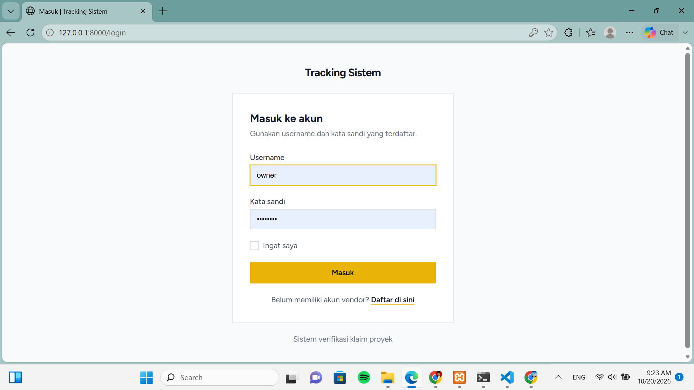
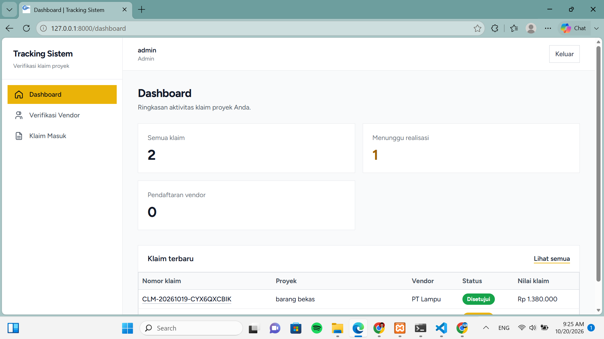
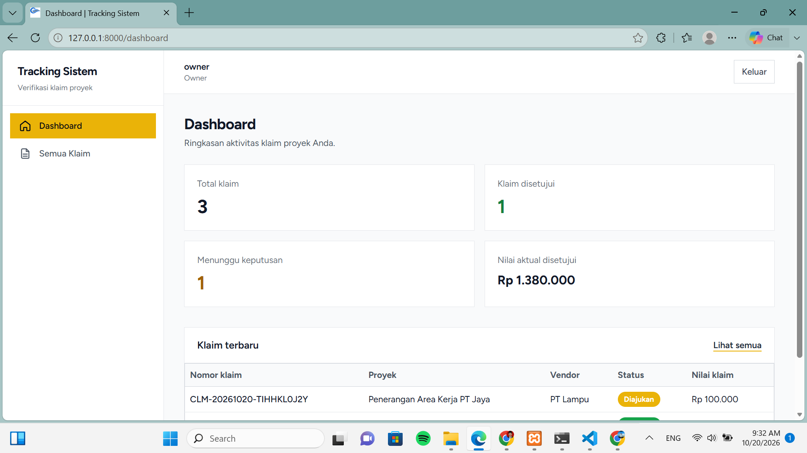
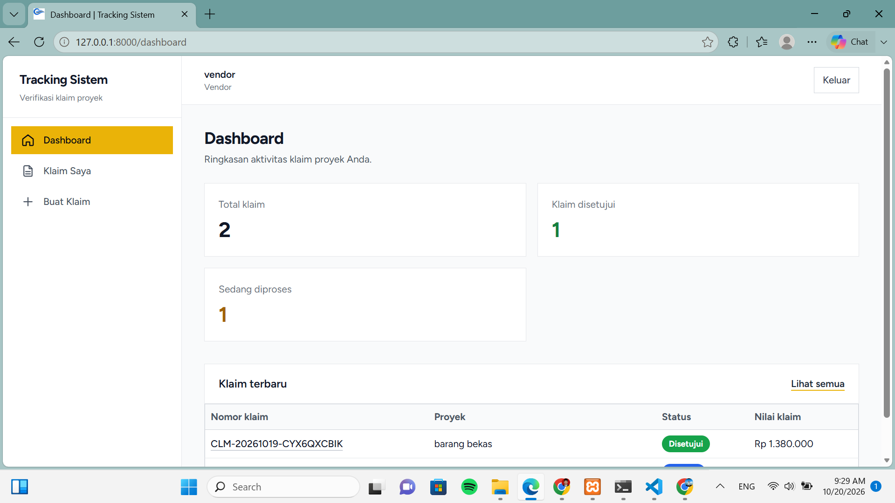
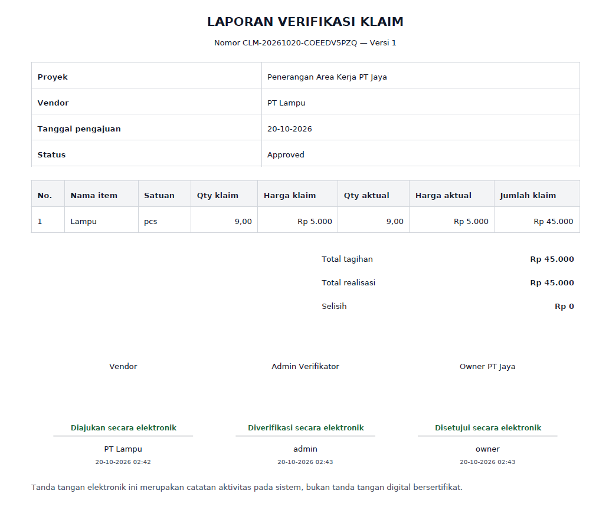

# Tracking Sistem - Project Claim Verification

Tracking Sistem adalah aplikasi verifikasi klaim tagihan proyek konstruksi. Aplikasi ini membantu pihak Owner, Admin (Site Manager), dan Vendor mencocokkan klaim pekerjaan dengan kondisi aktual di lapangan sebelum tagihan disetujui.

## 📖 Latar Belakang (Studi Kasus)

PT Jaya (Owner) menerima tagihan dari PT Lampu (Vendor) untuk pemasangan 10 lampu di area kerja. Karena tidak bisa memantau lapangan setiap hari, Owner mengalami kesulitan memverifikasi apakah tagihan tersebut sesuai dengan yang benar-benar terpasang.

Tracking Sistem hadir sebagai solusi "meja pertemuan" digital. Sistem membandingkan data klaim dari Vendor dengan data realisasi lapangan yang diinput oleh Admin (Site Manager). Owner kemudian dapat mengambil keputusan Approve atau Reject berdasarkan data yang akurat, dilengkapi bukti foto dan rekam jejak diskusi serta revisi.

## ✨ Fitur Utama

- **Multi-role access:** hak akses Vendor, Admin, dan Owner disesuaikan dengan tanggung jawab masing-masing.
- **Perbandingan otomatis:** klaim dan realisasi lapangan dibandingkan, dengan selisih ditandai agar mudah ditinjau.
- **Bukti foto:** Admin dapat menyertakan bukti kondisi aktual di lapangan.
- **Kolom diskusi:** Vendor, Admin, dan Owner dapat berkomunikasi pada klaim terkait.
- **Sistem revisi (versioning):** Vendor dapat mengirim revisi atas klaim yang ditolak, sementara riwayat versi sebelumnya tetap tersedia.
- **Notifikasi email otomatis:** pemberitahuan alur klaim dikirim melalui antrean (queue).
- **Export PDF formal:** rincian klaim dapat diunduh sebagai laporan PDF.
- **Pencarian dan filter:** membantu menemukan klaim berdasarkan informasi yang tersedia di aplikasi.

## 🛠️ Teknologi yang Digunakan

- **Backend:** Laravel 12, PHP 8.3 atau lebih baru
- **Database:** MySQL
- **Frontend:** Blade, Tailwind CSS, Alpine.js
- **Autentikasi:** Laravel Breeze
- **PDF:** `barryvdh/laravel-dompdf`
- **Email untuk pengembangan:** Mailtrap (SMTP)
- **Build frontend:** Vite

## ✅ Prasyarat

Pastikan perangkat pengembangan telah memiliki:

- PHP 8.3 atau lebih baru beserta ekstensi yang dibutuhkan Laravel
- Composer
- Node.js dan npm
- MySQL

## 🚀 Cara Menjalankan Project Secara Lokal

1. Clone repository dan masuk ke folder project:

   ```bash
   git clone https://github.com/fahryanRizky/tracking-sistem.git
   cd tracking-sistem
   ```

2. Pasang dependency PHP dan frontend:

   ```bash
   composer install
   npm install
   ```

3. Siapkan file environment dan application key:

   ```bash
   cp .env.example .env
   php artisan key:generate
   ```

   Di Windows Command Prompt, `copy .env.example .env` dapat digunakan sebagai pengganti perintah `cp`.

4. Buat database MySQL bernama `tracking_sistem`, lalu sesuaikan konfigurasi database di `.env`:

   ```dotenv
   DB_CONNECTION=mysql
   DB_HOST=127.0.0.1
   DB_PORT=3306
   DB_DATABASE=tracking_sistem
   DB_USERNAME=root
   DB_PASSWORD=
   ```

   Sesuaikan username dan password dengan konfigurasi MySQL lokal.

5. Jalankan migrasi dan seeder untuk membuat tabel serta data demo:

   ```bash
   php artisan migrate:fresh --seed
   php artisan storage:link
   ```

   **Perhatian:** `migrate:fresh` menghapus seluruh tabel pada database yang sedang dikonfigurasi. Gunakan hanya pada database pengembangan yang aman untuk di-reset.

6. Konfigurasikan SMTP Mailtrap pada `.env` jika ingin menguji pengiriman email. Gunakan kredensial Mailtrap milik Anda sendiri; jangan memasukkan kredensial tersebut ke repository.

7. Jalankan aplikasi. Buka terminal terpisah untuk setiap proses:

   ```bash
   php artisan serve
   ```

   ```bash
   npm run dev
   ```

   ```bash
   php artisan queue:work
   ```

8. Buka URL yang ditampilkan oleh `php artisan serve` (biasanya `http://127.0.0.1:8000`) di browser.

## 🔐 Akun Demo (Seeder)

Seeder menyediakan akun lokal berikut:

| Role | Username | Password |
| --- | --- | --- |
| Owner | `owner` | `owner123` |
| Admin | `admin` | `admin123` |
| Vendor | `vendor` | `vendor123` |

Gunakan akun ini hanya untuk pengembangan dan demo lokal. Ganti atau nonaktifkan kredensial demo sebelum aplikasi digunakan di lingkungan produksi.

## 📸 Screen Shoot

Letakkan file gambar dengan nama yang tercantum di bawah ke folder `public/screenshots/`. Folder ini telah disertakan di repository dengan file `.gitkeep` sebagai placeholder. Setelah gambar ditambahkan, gambar akan ditampilkan di bagian ini:

### 1. Halaman Login



### 2. Dashboard Admin



### 3. Dashboard Owner



### 4. Halaman Vendor



### 5. Kolom Diskusi


### 6. Hasil Export PDF


